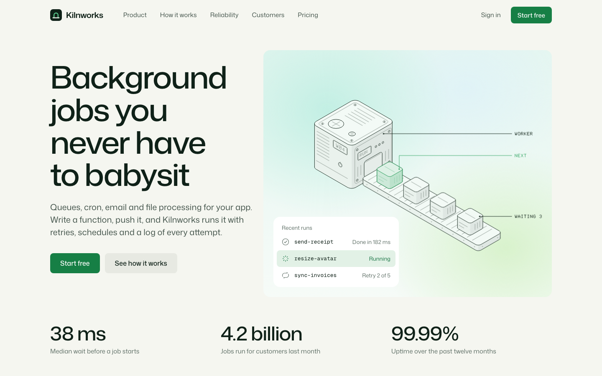

# Kilnworks

A free landing page template for a made-up developer product called Kilnworks: background jobs, queues, cron and email for app teams. It is illustrated with ten animated Isometric assets by [Illos](https://illos.dev).

[](https://vercel.com/new/clone?repository-url=https%3A%2F%2Fgithub.com%2Fnavedux%2Fillos-kilnworks-template)

Live demo: https://illos-kilnworks-template.vercel.app



The page has a hero with a live-looking queue, product tabs that swap their panel and animation, three stacked step cards with copyable code, a reliability list, a loose wall of customer quotes, pricing and a closing band. It is light only and has no build-time framework.

Kilnworks is not a real company. Change the name, the copy and the numbers to your own.

## Run it

You need Node 18 or later.

```
npm install
npm run dev
```

Then open the address Vite prints, usually http://localhost:5173.

## Build it

```
npm run build
```

The finished site goes to `dist/`. It is plain HTML, CSS and JavaScript, so any static host can serve it. `npm run preview` serves `dist/` locally so you can check the build.

## Edit it

- `index.html` holds the page and all its copy.
- `src/style.css` holds the styles. Colours, the type scale, the spacing steps and the two radii are CSS variables at the top.
- `src/main.js` runs the mobile menu, the product tabs (click, or the arrow keys, Home and End) and the copy buttons on the code blocks.
- `illos/` holds the animated assets as SVG files.

Each asset sits in the page as a comment such as `<!-- illos:queue -->`. The build swaps the comment for the SVG inline, so the asset can read the page's colours. To move one, move its comment. To use another, drop the SVG into `illos/` and add a comment with its file name. Use each file once per page.

The assets take their colours from the `--illos-*` variables in `src/style.css`. Change `--accent` and the highlight in every asset follows. Each gradient well (`.well--mint`, `.well--meadow`) sets its own `--illos-ground`, so the assets read as light objects floating on it.

## How the motion behaves

- Each asset loops while it is on screen and pauses when it scrolls away or sits in a hidden tab.
- With reduced motion turned on in the system settings, every asset shows one still frame.
- Nothing else on the page moves on its own. On wide screens the three step cards stack as you scroll.

## Fonts

Mona Sans and Geist Mono are self-hosted in `public/fonts` under the SIL Open Font License (the licence files sit next to them). To change them, swap the files and the `@font-face` rules at the top of `src/style.css`.

## Licence

The code is MIT. The animated assets are free to use in sites you build from this template, but not to redistribute on their own. See `LICENSE.md`.

## More animated assets

The assets come from [Illos](https://illos.dev), where there are more in the same style, along with the skills that let your coding agent make new ones.
